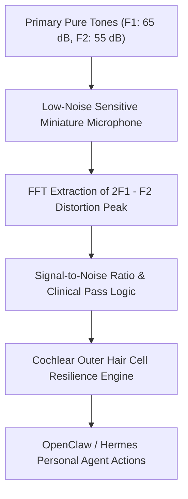

# Distortion Product Otoacoustic Emissions (DPOAE) Skill

[](LICENSE)
[](https://www.python.org/)
[](requirements.txt)
[](mcp_server.py)
[](SKILL.md)

Zero-dependency sovereign personal agent skill for non-invasive evaluation of Distortion Product Otoacoustic Emissions (DPOAE), cochlear outer hair cell biomechanics, and headphone noise damage.



## Features
- **Deterministic Math**: Pure Python standard library implementation with zero external dependencies.
- **Clinical Audiological Standards**: Implements clinical pass criteria ($SNR \ge 6 \text{ dB}$, $Amp \ge -5 \text{ dB SPL}$).
- **Early Noise Overexposure Detection**: Identifies outer hair cell fatigue before pure-tone hearing threshold loss occurs.
- **Model Context Protocol (MCP)**: Native JSON-RPC tool integration for LLMs and autonomous agents.

## Quickstart

```python
from client import AcousticOtoacousticEmissionsClient

client = AcousticOtoacousticEmissionsClient()
result = client.evaluate_dpoae(
    f2_frequency_hz=2000.0,
    dpoae_amplitude_db_spl=8.5,
    noise_floor_db_spl=-12.5
)
print("DPOAE SNR:", result["signal_to_noise_ratio_snr_db"], "dB")
print("Classification:", result["classification"])
```

## License
Apache-2.0
